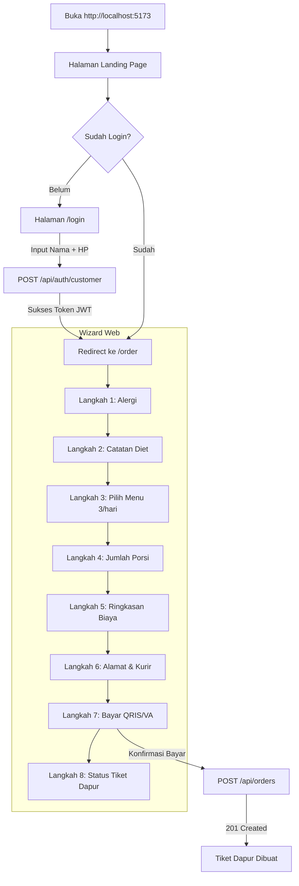
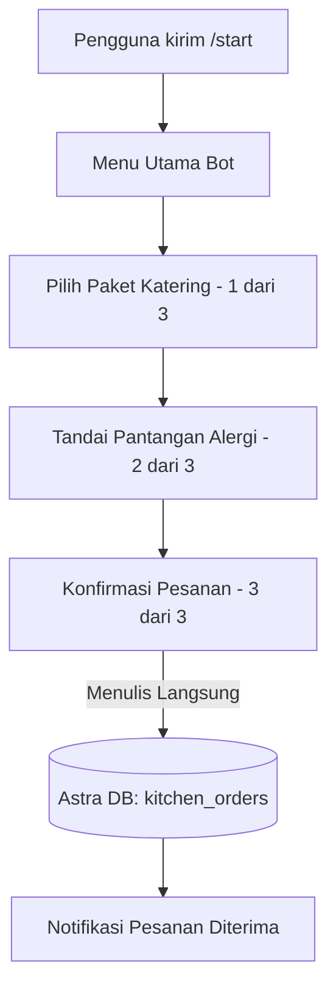

# Alur Saat Ini (Current Flow) — Web & Telegram

Dokumen ini memetakan diagram alur sistem aktual yang berjalan sebelum perbaikan arsitektur Fase R.

---

## 1. Alur Web Saat Ini (`frontend`)

### Karakteristik & Limitasi Web Saat Ini:
1. State progres disimpan di memori klien (React State); bila browser ditutup dan dibuka di perangkat lain, progres belum tersambung via server-side `OrderDraft`.
2. Timer countdown 10 menit berjalan di browser, namun belum terintegrasi dengan job pembatalan otomatis di server (background scheduler) jika batas waktu habis.
3. Alamat tersimpan masih berupa mock statis di antarmuka (belum ada CRUD tabel `addresses` di database).

---

## 2. Alur Bot Telegram Saat Ini (`telegram_bot.py`)

### Masalah Arsitektur Bot Saat Ini:
1. **Duplikasi Logika Bisnis:** Bot tidak memanggil FastAPI backend, melainkan mengimpor modul `data.py` dan memanggil koneksi Astra DB secara langsung.
2. **Inkonsistensi Alur:** Bot memakai alur 3 langkah ringkas, sementara Web memakai wizard pilihan menu harian.
3. **Pilihan Menu Harian Tidak Tersedia di Bot:** Bot hanya memilih paket (3, 5, atau 6 hari) tanpa membiarkan pelanggan memilih salah satu dari 3 menu harian per hari layanan.
