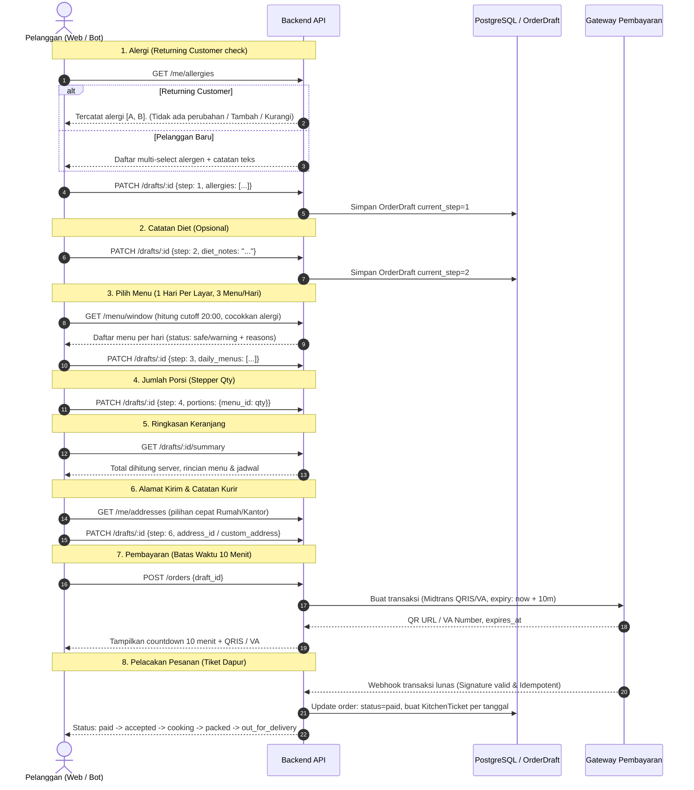

# Alur Target (Target Flow) — Dapur Harian (Bagian A 4.1 – 4.3)

Diagram target ini menjadi acuan tunggal (*single source of truth*) untuk Web dan Bot Telegram. Keduanya adalah **klien tipis** dari satu backend yang sama.

---

## 1. Arsitektur Target (Satu Backend Tunggal)

```mermaid
flowchart TD
    subgraph Klien
        WEB[React Web App - apps/web]
        BOT[Telegram Bot - aiogram 3 / apps/bot]
    end

    subgraph Backend Tunggal - FastAPI
        API_AUTH[/api/auth & /me]
        API_DRAFT[/api/drafts Server-side OrderDraft]
        API_MENU[/api/menu/window Jendela & Pencocokan Alergi]
        API_ORDER[/api/orders & /api/orders/:id/pay]
        API_ADDR[/api/me/addresses]
    end

    subgraph Data & Layanan
        DB[(PostgreSQL 16)]
        REDIS[(Redis 7)]
        PAY[Payment Gateway - Midtrans Sandbox]
    end

    WEB --> API_AUTH
    WEB --> API_DRAFT
    WEB --> API_MENU
    WEB --> API_ORDER
    WEB --> API_ADDR

    BOT --> API_AUTH
    BOT --> API_DRAFT
    BOT --> API_MENU
    BOT --> API_ORDER
    BOT --> API_ADDR

    API_AUTH --> DB
    API_DRAFT --> DB
    API_MENU --> DB
    API_ORDER --> DB
    API_ORDER --> REDIS
    API_ORDER --> PAY
```

---

## 2. Alur Wizard 8 Langkah Target (Satu Layar / Pesan = Satu Keputusan)


